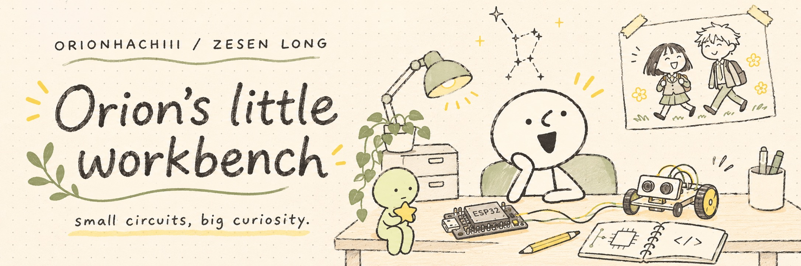

 

<a href="https://orionhachiii.github.io/zesen-portfolio/">Visit my portfolio ↗</a> &nbsp; · &nbsp; <a href="https://github.com/OrionHachiii?tab=repositories">All repositories ↗</a>

## 01 / A little about me

Hi, I'm **Zesen Long** — you can call me **Orion**. ✳

I'm studying **Computer Engineering at UC Irvine**, with an **ICS minor**. My interests sit where hardware meets software: embedded systems, robotics, edge AI, and hardware–software co-design.

I like turning ideas into things you can hold, play with, and learn from — from a brick-built game console to a tiny vision-powered device.

> 小电路，大好奇。欢迎来到我的涂鸦工作台。

## 02 / On the workbench

<table>
<tr>
<td width="50%" valign="top">

### ↳ Play / LEGO Game Console

A little console made with reusable bricks, an OLED, a joystick, and a buzzer. From Arduino Uno to a rewritten ESP32 version — build, play, rebuild.

**Arduino · ESP32 · C++**

[Open the build →](https://github.com/OrionHachiii/lego-game-console)

</td>
<td width="50%" valign="top">

### ↳ Sense / AI Trash Detector

An edge-AI course-project demo connecting a vision sensor to an ESP32 host, with classification results on a tiny OLED.

**ESP32S3 · UART · Edge AI**

[Peek inside →](https://github.com/OrionHachiii/ai-trash-detector)

</td>
</tr>
<tr>
<td valign="top">

### ↳ Move / Wall-Climbing Vehicle

A fan-adhesion prototype exploring how a vehicle can take the road up a wall. Includes the report, BOM, build photos, and testing notes.

**Robotics · Prototyping · ENGR 7**

[Follow the prototype →](https://github.com/OrionHachiii/wall-climbing-vehicle)

</td>
<td valign="top">

### ↳ Share / Hardware Workshop

Open ESP32 teaching materials from the IVC CS Club workshop I led, with setup guides and a brick-built console reference project.

**Hands-on learning · ESP32 · Documentation**

[Build along →](https://github.com/OrionHachiii/ivc-cs-club-hardware-workshop)

</td>
</tr>
</table>

<b>＋ Two more things on the shelf</b>

- [BOM Finder](https://github.com/OrionHachiii/bom-finder) — an AI-assisted hardware BOM generator demo, with a Next.js frontend and FastAPI backend.
- [IVC Echelon Exchange](https://github.com/OrionHachiii/IVC-Echelon-Exchange) — a LaserHack 2025 project.

## 03 / The little toolbox

| On the desk | In my projects |
| :--- | :--- |
| **Boards & firmware** | ESP32 / ESP32S3 · Arduino Uno · C++ |
| **Signals & interfaces** | UART · I²C · OLEDs · joysticks · buzzers |
| **Software around the hardware** | TypeScript · Next.js · React · FastAPI |
| **Things I'm curious about** | Robotics · edge AI · hardware–software co-design |

## 04 / Away from the keyboard

A little shelf for the things that make this space feel like me.

**✿ Skip and Loafer / 跃动青春**  
美津未、志摩，和那些让平凡日常闪闪发光的小瞬间。

**☘ SMISKI**  
喜欢躲在角落里的小绿人。这里也给它留了一个位置。

**✎ Simple doodles**  
两点眼睛，几根线条，一张有点呆萌的脸。我的头像，也是工作台的小主人。

## 05 / Say hello

Curious about a build, a workshop, or hardware that does something fun? Explore a project and open an issue there — I'd love to talk.

[Portfolio ↗](https://orionhachiii.github.io/zesen-portfolio/) &nbsp; · &nbsp; [Browse my code ↗](https://github.com/OrionHachiii?tab=repositories) &nbsp; · &nbsp; [Things I've starred ↗](https://github.com/OrionHachiii?tab=stars)

---

Thanks for stopping by. Leave a little room for curiosity. ✳ 
<a href="#about">Back to the top ↑</a>

